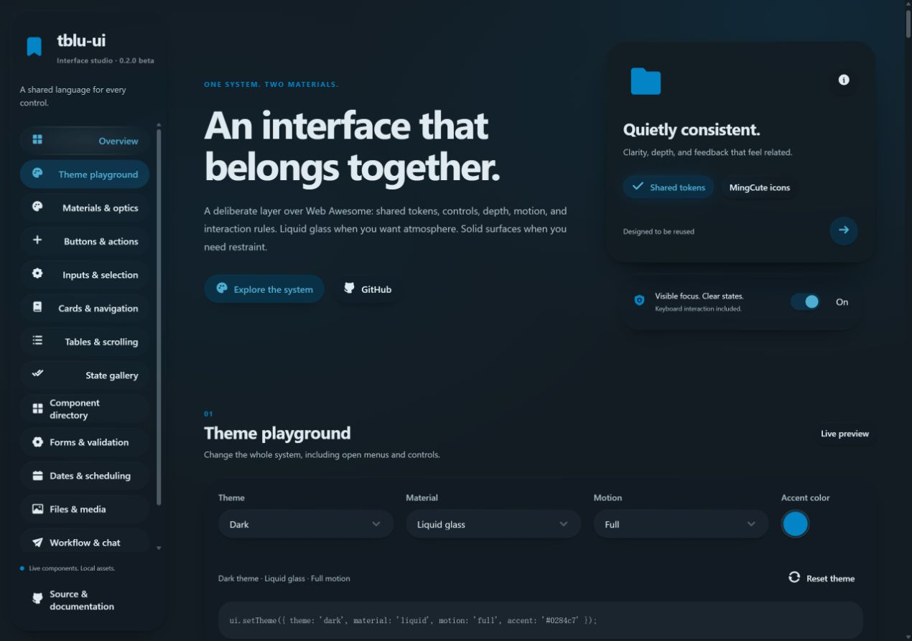
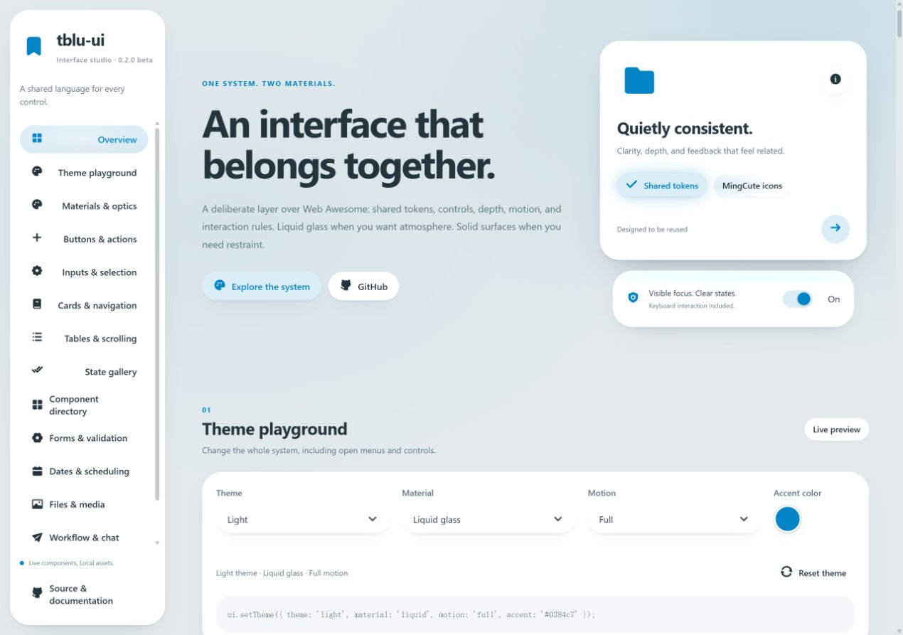
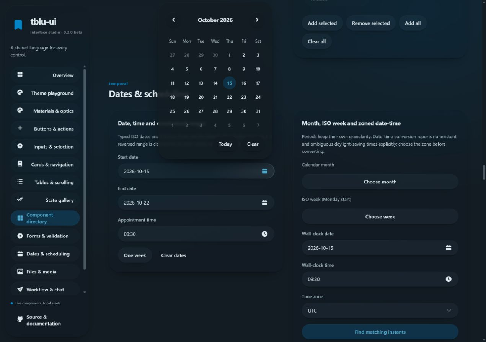

<div align="center">

# tblu-ui

**覆盖整站的统一界面系统**

液态玻璃与实体材质 · 浅色与深色主题 · 不绑定应用框架的 Web Components

[**打开组件演示站 →**](https://tonyblur.github.io/tblu-ui/) · [English](README.md) · [API 文档](docs/API.md) · [设计规范](DESIGN_SYSTEM.md)

**0.2.0 beta** · MIT 开源 · MingCute 图标 · Web Awesome · Motion

</div>



| 浅色主题 | 共用日历与表单材质 |
| --- | --- |
|  |  |

## 从网站场景组织组件

对照 [13 个主流 UI 生态的官方文档](docs/component-coverage-research.md)，整理了 112 类组件目录，涵盖九组：基础与布局、动作与导航、表单与验证、日期与排期、数据集合、浮层与反馈、文件媒体、协作流程、指标与编辑器。

演示站将 **105 类通用类型**关联到实际交互示例，并支持按组件和网站场景筛选。另有 7 类专业能力单独注明集成边界：本地日程、简单图表和 JSON 文本框不会冒充完整排期、专业绘图和代码编辑引擎。详见 [覆盖清单与限制](docs/COVERAGE.md)。

适用场景包括内容网站、账号与设置、管理后台、电商、预约排期、聊天协作、文件管理、数据看板和开发工具。

> **预发布阶段：** 1.0 之前的版本全部为 GitHub prerelease，API 仍可能调整。参见 [发布规则](docs/RELEASES.md) 与 [更新记录](CHANGELOG.md)。

为现代网页应用提供统一视觉和交互规范的 UI 框架，支持**液态玻璃**与**实体**两种材质。按钮、菜单、卡片、表格、表单、颜色选择器、滚动条、图标和动效共用一套设计变量与规则。

[English](README.md) · [设计系统规范](DESIGN_SYSTEM.md) · [演示网站源码](demo/) · [许可证](LICENSE)

仓库内置 GitHub Pages 工作流，目标演示地址为 [tonyblur.github.io/tblu-ui](https://tonyblur.github.io/tblu-ui/)。工作流成功部署后可访问。

## 框架包含什么

- 应用全局统一的材质、主题、颜色、尺寸、层级与交互反馈。
- 三种尺寸、四种用途的按钮；图标按钮为圆形，文字按钮为胶囊形，同尺寸等高。
- 基于 Web Awesome 的下拉选择、颜色选择器、开关和单选组件，通过统一适配器使用。
- 原生表单控件保留值、事件和表单提交语义。
- 共用定位、关闭逻辑与键盘操作的飞出菜单和浮层。
- 项目图标与控件内部图标统一采用 MingCute。
- 键盘焦点、选中、禁用、错误、加载及减少动态效果等状态。
- 包含真实交互、组件状态和响应式布局的演示网站。

tblu-ui 在 Web Awesome 与 Motion 的基础上制定统一规范和适配层。业务逻辑、数据、页面布局由使用它的应用负责。

## 运行演示网站

需要 Node.js 22.13 或更高版本。

```sh
npm ci
npm run dev
```

打开 Vite 输出的本地地址，演示入口为 `demo/index.html`。检查与构建命令：

```sh
npm test
npm run check
npm run build
npm run preview
```

## 接入项目

首个版本以 Git 仓库作为分发来源，无需依赖 npm 公共仓库发布。

```sh
npm install github:TonyBlur/tblu-ui#v0.2.0-beta.1 @awesome.me/webawesome motion
```

包名为 `@tblu/ui`。使用支持 CSS 导入与 ES 模块的打包器，例如 Vite。在浏览器端、DOM 就绪后初始化：

```js
import '@tblu/ui/styles.css';
import { mountUI, icon, openMenu } from '@tblu/ui';

const ui = await mountUI(document, {
  theme: 'system',
  material: 'liquid',
  motion: 'full',
  accent: '#0284c7',
  enhanceNative: true,
});

ui.setTheme({ theme: 'dark', material: 'solid' });
ui.refresh(); // 必要时在内容更新后刷新
// ui.destroy(); // 页面宿主卸载时释放观察器与适配器
```

应用容器添加 `.tblu-ui`。初始化会为主题根元素添加 `.tblu-root`。局部初始化可传入元素，并在需要时设置 `themeRoot`；浮层应处于同一应用的主题环境。

```html
<div class="tblu-ui">
  <article class="tblu-card" data-tblu-surface="card">
    <h2>收藏设置</h2>
    <label class="tblu-field">
      <span>排序方式</span>
      <select name="sort">
        <option value="original">原始顺序</option>
        <option value="title">名称</option>
      </select>
    </label>
    <label class="tblu-switch">
      <input type="checkbox" name="autoSync" />
      <span>自动同步</span>
    </label>
    <button class="tblu-button" data-tblu-variant="primary">保存更改</button>
  </article>
</div>
```

启用 `enhanceNative: true` 后，下拉选项列表和颜色选择弹窗由 Web Awesome 组件呈现，不再使用操作系统的原生菜单。展开后的界面也共用框架设计变量，支持明暗主题和两种材质；原生控件继续作为表单数据来源。

样式不能替代语义。应用必须提供可访问标签，并按真实状态设置 `aria-pressed`、`aria-selected`、`aria-invalid`、`disabled` 等属性。

### 主要 API

| API | 用途 |
| --- | --- |
| `mountUI(root, options)` | 初始化主题、控件适配器、图标和材质，异步返回实例。 |
| `ui.setTheme(patch)` | 验证并更新主题，所有组件同步使用。 |
| `ui.refresh()` | 内容变化后刷新控件与材质几何。 |
| `ui.destroy()` | 移除适配器并释放实例。 |
| `ui.theme` | 获取当前配置的副本。 |
| `mountControls(root, options)` | 仅接入原生表单适配器。 |
| `createMaterial(options)` | 在应用集成层直接管理材质生命周期。 |
| `icon(name)` / `iconURL(name)` | 获取已知 MingCute 图标的 SVG 字符串或数据 URL。 |
| `openMenu(anchor, options)` | 打开锚定按钮的操作菜单。 |
| `createPopover(anchor, options)` | 根据内容节点创建锚定浮层。 |
| `destroyOverlays(root)` | 清理根元素内触发的浮层；`ui.destroy()` 也会调用。 |
| `motion` | 共用的进出场与交互动效工具。 |

主题可配置 `theme`（`system`、`light`、`dark`）、`material`（`liquid`、`solid`）、`motion`（`full`、`reduced`）、`accent`（六位十六进制颜色）、`blur` 和 `contrast`。应通过 API 设置，而不是在不同页面重复覆盖视觉规则。

```js
const actions = document.querySelector('#collectionActions');
actions.innerHTML = icon('MoreHorizontal');
actions.addEventListener('click', () => openMenu(actions, {
  label: '收藏操作',
  items: [
    { label: '编辑', icon: 'Pencil', onSelect: () => editCollection() },
    { label: '删除', icon: 'Trash2', variant: 'danger', onSelect: () => confirmDeletion() },
  ],
}));
```

业务确认、权限及持久化由应用负责。Escape 和点击外部关闭菜单；方向键、Home、End 在可用选项之间移动，Tab 继续到页面的下一个控件。再次点击同一触发按钮会关闭浮层，移除触发按钮也会释放对应浮层。

操作回调在点击事件内立即调用，使 `window.open()` 等操作保留浏览器的用户激活权限。异步操作失败可通过 `onError(error)` 处理，或监听触发按钮上冒泡的 `tblu-error` 事件；可见错误提示由应用提供。

## 系统化使用规则

新增控件前请阅读 [DESIGN_SYSTEM.md](DESIGN_SYSTEM.md)。设计变量、组件类与适配器是唯一公共规范。应用样式放在较低优先级的 `app` 层，只定义页面布局、区块间距和内容排版。不要在每个页面重新定义控件材质、形状、阴影、焦点或反馈。

需要新的通用组件或变体时，应在框架内实现、补充演示状态并完成验证，再以版本更新的方式接入应用。

## 贡献与验证

修改应围绕可复用的规范展开。新功能需有演示示例，并为控件适配或状态变化提供有意义的测试。验证应覆盖明暗主题、两种材质、窄屏、键盘操作及减少动态效果。规范检查脚本提供约束，但不能代替浏览器实际检查。

## 许可证与鸣谢

采用 MIT 许可证，保留派生来源 Pintree.io 的 MIT 声明。MingCute SVG 图标采用 Apache-2.0；Web Awesome 与 Motion 采用 MIT。详情见 [THIRD_PARTY_NOTICES.md](THIRD_PARTY_NOTICES.md) 和随包附带的许可证文本。
## CI 与演示网站部署

[CI 与演示网站工作流](.github/workflows/ci-pages.yml) 会在拉取请求和 `main` 分支推送时执行 `npm ci`、规范检查、测试、演示构建和包内容检查。拉取请求不会部署；`main` 成功运行后，将 `demo-dist` 上传为 Pages 构建产物，并通过 `github-pages` 环境部署。

在仓库 **Settings → Pages** 中，将构建部署来源设置为 **GitHub Actions**。务必提交 `package-lock.json`。工作流使用 `PAGES_BASE=/tblu-ui/`，部署任务独立运行，仅授予需要的 Pages 和 OIDC 写权限。Actions 固定到已核验的官方发布提交，升级时应同步检查并更新。发布要求参见 [GitHub 自定义 Pages 工作流文档](https://docs.github.com/en/pages/getting-started-with-github-pages/using-custom-workflows-with-github-pages)。

如果 fork 后的仓库名称不同，需要同时修改 `PAGES_BASE` 和演示／源码链接。静态演示无需生产环境凭据；npm 公共仓库发布属于独立流程，该工作流不会执行。
